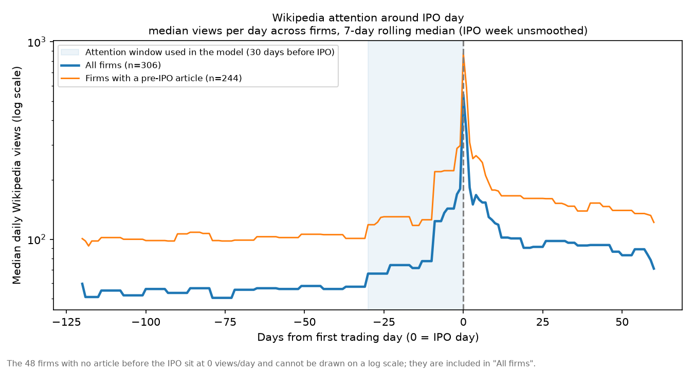
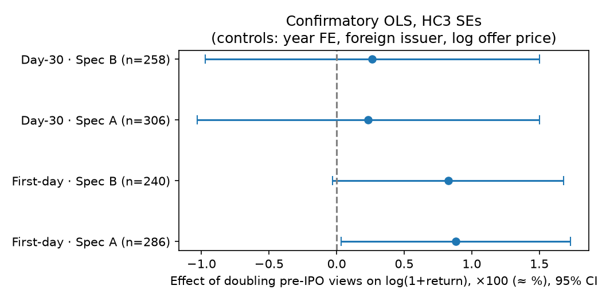
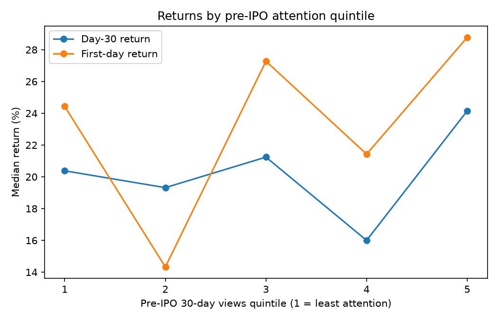
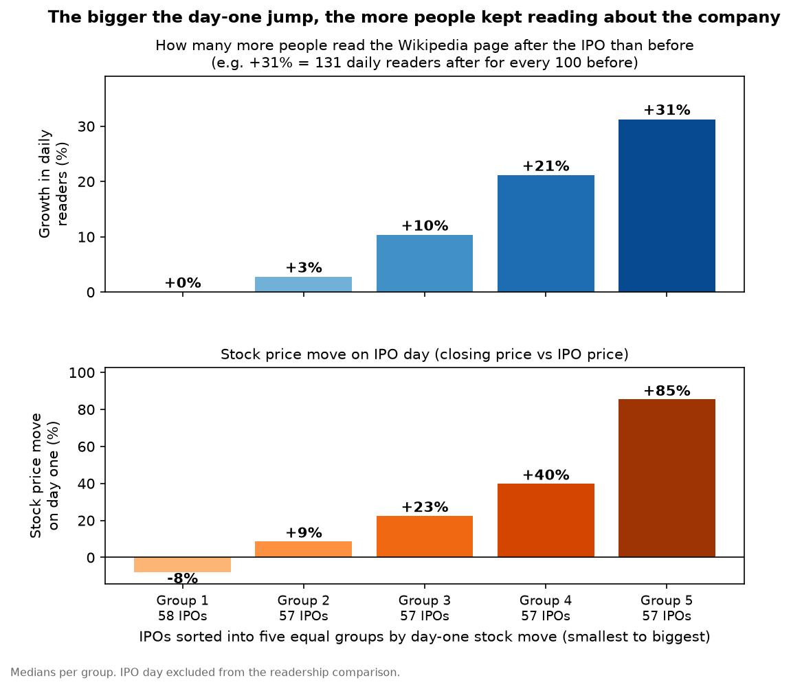

# Does Wikipedia attention before an IPO predict its returns?

**Short answer: barely, and only on day one.** In 294 US IPOs from 2019–2025, doubling a company's Wikipedia pageviews in the 30 days before listing goes with about **+0.9%** in (1 + first-day return) (95% CI +0.08% to +1.7%, p = 0.032, n = 287). By day 30 there's nothing there (+0.1%, p = 0.91). The stronger pattern runs the other way: **the first-day pop drives attention afterwards**.

## Headline findings

- **Baselines.** Median first-day return is 21.9% (n = 287; 78% positive). Median day-30 return is 20.0% (n = 294; 74% positive).
- **Confirmatory model** (pre-registered; OLS with HC3 standard errors; year fixed effects, foreign-issuer flag, log offer price):
  - First-day: +0.91% per doubling of views (p = 0.032). It passes the pre-set decision rule, since the robustness spec has the same sign (+0.83%, p = 0.052, n = 238). Attention adds 0.009 to R².
  - Day-30: +0.07% per doubling (p = 0.91). Null.
- **No article = still pops.** Firms with no Wikipedia article until after their IPO (49 firms) had *higher* returns, with the controls held fixed: +0.23 in log(1 + first-day return), p < 0.001.
- **Pop drives attention.** By first-day-return quintile, median IPO-day views go from 304 (weakest pop) to 1,197 (strongest). The median ratio of after-IPO to before-IPO daily views goes from 1.02 to 1.30.
- **Size (post-hoc).** IPO market cap correlates strongly with attention (Spearman 0.49 with pre-IPO views) but not with returns (−0.03 with first-day return, −0.03 with day-30). Controlling for size nudges the first-day attention effect up to +1.18% per doubling (p = 0.014, n = 258). That's a lead for a future pre-registered test, not a finding.

| | |
|---|---|
|  |  |
|  |  |

The full write-up is in [docs/report.md](docs/report.md).

## Reproduce

Raw data is **not** in this repo. Price data comes from Tiingo, and you need your own subscription. Keys are read from environment variables and are never printed or logged:

```bash
export TIINGO_API_KEY=...        # your own Tiingo key; sent only in the Authorization header
pip install -r requirements.txt
```

Pipeline order (run from the repo root):

1. `scripts/parse_424b4.py`, `add_424b1.py`, `postprocess_deals.py`, `sector_v2.py`: IPO universe and offer prices from SEC EDGAR.
2. `scripts/wikidata_ticker_map.py`, `match_all.py`, `reclassify_search_miss.py`, `deep_search_miss.py`: Wikipedia matching and pageview cache.
3. Manual review of uncertain matches (`make_review_worksheet.py`, rules in `docs/review-checklist.md`).
4. `scripts/sec_only_dates.py` (SEC-only first-trade dates and already-listed check), then `scripts/tiingo_prices.py --all` (returns on the SEC date only; local only).
5. `scripts/build_analysis_set.py` → `fetch_analysis_views.py` → `build_analysis_table.py` → `update_analysis_table.py` → `parse_shares_outstanding.py`.
6. `notebooks/01_eda.ipynb`, `notebooks/02_model.ipynb`.
7. `scripts/build_public_aggregates.py` → `scripts/make_figures.py`.
8. Tests: `python3 tests/test_public_aggregates.py && python3 tests/test_app.py`.

SEC requests use a descriptive User-Agent with a contact email and stay at 8 requests/second or fewer. Wikimedia requests use a descriptive User-Agent at about 3 requests/second.

## App

```bash
streamlit run app/streamlit_app.py
```

The app reads only `data/public/*.csv`: aggregates over at least 15 firms, precomputed for both settings of the "include IPOs with no pre-IPO Wikipedia article" toggle.

## Layout

```
app/            Streamlit app (public aggregates only)
data/public/    aggregate CSVs, every group n >= 15 (committed)
data/...        raw, cache, processed, local_only: not committed
docs/           report, review checklist, coverage, licensing notes
figures/        static PNGs (aggregates only)
notebooks/      01 EDA, 02 confirmatory model
scripts/        pipeline
tests/          public-data and app tests
```

## Data sources and licenses

- **SEC EDGAR** (https://www.sec.gov/edgar): prospectuses (424B4/424B1), company submissions. US government public data.
- **Wikimedia Pageviews REST API** (https://wikimedia.org/api/rest_v1/): daily human pageviews. CC0.
- **Wikidata** (https://www.wikidata.org): CIK and ticker links to articles. CC0.
- **Wikipedia** (https://en.wikipedia.org): article titles, redirects and revision dates via the MediaWiki API. Text is CC BY-SA; only metadata is used here.
- **Tiingo** (https://www.tiingo.com): end-of-day prices. Licensed. Only aggregates over at least 15 IPOs are published; no per-company prices or returns are in this repo.

## Limitations (short version)

- **The effect is concentrated in the biggest pops.** Dropping outliers instead of log-compressing them shrinks the effect to about +0.4% per doubling (p ≈ 0.36). See report §4.6.

- Only IPOs with a confirmed Wikipedia match and usable prices are included (294 of 1,410 operating-company IPOs), so obscure firms are under-represented.
- For a few firms (fewer than 15) the vendor's first close equals the offer price exactly, which looks like a placeholder; their first-day return is treated as missing.
- First-trade dates come from SEC filings only. Where SEC data gives no date, the return is left missing rather than dated from price data.
- **One judgment call moves the headline.** A first close under 20% of the offer price is treated as bad data (almost surely a ticker now held by another company), which drops one firm, Sunnova. Keeping Sunnova in moves the first-day p-value from 0.032 to 0.070, above the 0.05 bar.
- Some IPOs price and trade on the same day, so a few SEC-derived first-trade dates may really be the second trading day. SEC data can't settle this, so those dates are kept as derived and no firm is dropped for it.
- 49 firms had no article before the IPO. The main spec counts them as zero attention (with a dummy); the robustness spec drops them.
- Correlation, not causation. The sector and size analyses are exploratory.

See [docs/report.md](docs/report.md#limitations) for the full list.
